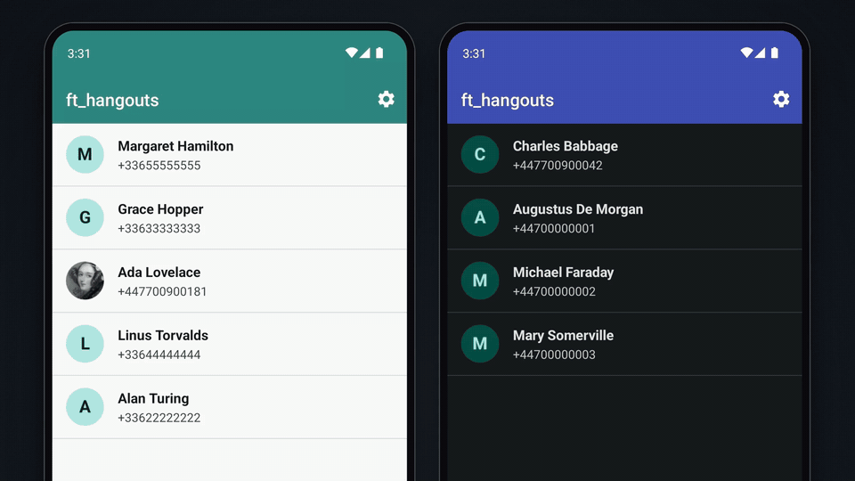

# ft_hangouts

A contacts and SMS app for Android, built for the 42 `ft_hangouts` project.
Written in Kotlin on top of the plain Android framework: no AndroidX, no third-party libraries.

<p align="center">
  
</p>

## Features

- **Contacts**: create, edit and delete contacts (first name, last name, phone, email, note), sorted by last name.
  Each contact gets a photo picked from the device, or a generated initial avatar.
- **Profile**: long-press a contact to see its details before editing it.
- **SMS**: tap a contact to open the conversation and send messages, long ones are split automatically.
  Incoming SMS are stored and shown live in the open conversation; a message from an unknown number creates a new contact.
- **Calls**: call a contact from its conversation, or fall back to the dialer if the permission is refused.
- **Customisation**: header colour (Teal, Indigo, Crimson, Slate), light / dark / system theme, and English / French / system language.
- **Last seen**: a toast shows when the app was last sent to the background.

Contacts and messages are stored locally in SQLite, settings in `SharedPreferences`.

## Build

Requirements: JDK 17 and the Android SDK (platform 34). The app runs on Android 9 (API 28) and above.

```sh
echo "sdk.dir=$HOME/Android/Sdk" > local.properties   # or set ANDROID_HOME
./gradlew assembleDebug                               # app/build/outputs/apk/debug/app-debug.apk
./gradlew installDebug                                # install on a connected device or emulator
```

On an emulator, an incoming SMS can be simulated with:

```sh
adb emu sms send +33612345678 "Hello"
```

## Project structure

```
app/src/main/java/com/fortytwo/hangouts/
├── MainActivity.kt            contact list
├── ContactProfileActivity.kt  contact details
├── ContactFormActivity.kt     add / edit / delete a contact
├── ConversationActivity.kt    messages, sending SMS, calling
├── SettingsActivity.kt        header colour, language, theme
├── SmsReceiver.kt             incoming SMS
├── DatabaseHelper.kt          SQLite storage (DbContract.kt for the schema)
├── BaseActivity.kt            applies the saved theme and language
├── HangoutsApp.kt             "last backgrounded" toast
└── AppearanceUtils.kt, PhotoUtils.kt, Prefs.kt
```
